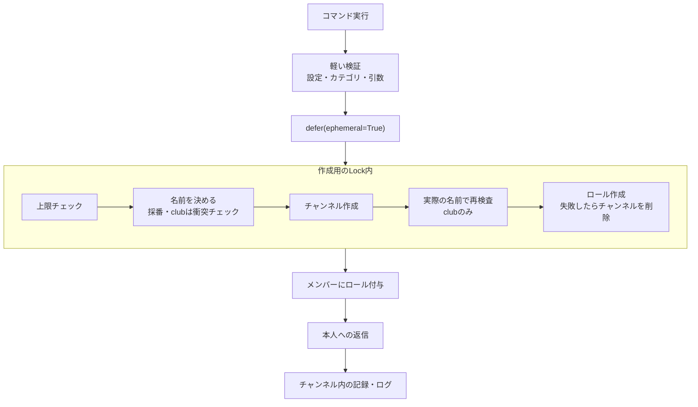

# アーキテクチャガイド

このドキュメントでは、InTech Discord Botの技術スタックとアーキテクチャパターンについて説明します。

## 📋 目次

1. [技術スタック](#技術スタック)
2. [アーキテクチャパターン](#アーキテクチャパターン)
3. [コマンド登録システム](#コマンド登録システム)
4. [設定管理](#設定管理)
5. [イベントチャンネルのインデックス管理](#イベントチャンネルのインデックス管理)
6. [作成の直列化と上限チェック](#作成の直列化と上限チェック)
7. [記録の出し先](#記録の出し先)

## 技術スタック

- **言語**: Python 3.11+
- **Discordフレームワーク**: discord.py 2.6.4+ (モダンなスラッシュコマンド with `app_commands`)
- **Webサーバー**: FastAPI + uvicorn (Keep-alive用ヘルスチェックサーバー)
- **パッケージマネージャー**: `uv` (モダンなPythonパッケージマネージャー)
- **デプロイ**: Fly.io (東京リージョン、Docker ベース)

## アーキテクチャパターン

### デュアルサーバーアーキテクチャ

Botは2つの並列サーバーを実行します:

1. **Discord Bot** ([bot.py](../bot.py)) - スラッシュコマンドを持つメインのDiscordクライアント
2. **FastAPI Server** ([keep_alive.py](../keep_alive.py)) - ヘルスチェックエンドポイント (`/`, `/health`, `/ping`)

両方のサーバーは[bot.py](../bot.py)内で`asyncio.gather()`を使用して実行されます。これにより、HTTPエンドポイントを必要とするプラットフォーム(Fly.ioなど)へのデプロイが可能になります。

**実装コード** ([bot.py](../bot.py)):
```python
async def main():
    async with bot:
        # Discord BotとFastAPIサーバーを並列実行
        await asyncio.gather(
            bot.start(token),
            run_keep_alive()
        )
```

### ステートレス設計

**データベース不要** - すべての状態はDiscord上に存在:

- チャンネル、ロール、カテゴリーが唯一の真実の情報源
- Botを再起動してもデータ損失なし
- 設定は環境変数から取得

この設計により、以下のメリットがあります:
- シンプルな構成（DBサーバー不要）
- 高い可用性（状態同期の問題なし）
- 簡単なバックアップ（Discordが管理）

## コマンド登録システム

**これがコードベースで最も重要なアーキテクチャパターンです。**

### 自動検出と登録

コマンドは起動時に自動検出・登録されます:

1. **場所**: [src/commands/\_\_init\_\_.py](../src/commands/__init__.py)
2. **自動検出**: `src/commands/` 内のファイルが自動的にロードされます（`_*.py` ファイルを除く）
3. **各コマンドモジュール**は `setup(tree: app_commands.CommandTree)` 関数を持つ必要があります
4. **動的ロード**: `importlib` を使用したクリーンなモジュール管理

### 登録の仕組み

[src/commands/\_\_init\_\_.py](../src/commands/__init__.py):
```python
def register_commands(tree: app_commands.CommandTree):
    """自動的にコマンドを登録"""
    commands_dir = Path(__file__).parent

    for file_path in commands_dir.glob("*.py"):
        # _で始まるファイル（__init__.py, _sample.pyなど）を除外
        if file_path.stem.startswith("_"):
            continue

        # モジュールを動的にインポート
        module_name = f"src.commands.{file_path.stem}"
        module = importlib.import_module(module_name)

        # setup関数を呼び出してコマンドを登録
        if hasattr(module, "setup"):
            module.setup(tree)
```

### 新しいコマンドの追加

1. `src/commands/` に新しいファイルを作成（例: `my_command.py`）
2. `setup(tree)` 関数を実装
3. デコレーターパターンを使用（詳細は[ADD_COMMAND.md](./ADD_COMMAND.md)参照）
4. コマンドは自動的に `/help` と `/docs` に表示されます

**テンプレート**: [src/commands/\_sample.py](../src/commands/_sample.py)を起点として使用

### コマンドの同期

開発環境と本番環境で異なる同期戦略を使用:

**開発環境** (`.env.dev` with `DEV_GUILD_ID`):
```python
if dev_guild_id:
    # 即座に同期（開発モード）
    guild = discord.Object(id=int(dev_guild_id))
    tree.copy_global_to(guild=guild)
    synced = await tree.sync(guild=guild)
```

**本番環境** (`.env` without `DEV_GUILD_ID`):
```python
else:
    # グローバル同期（最大1時間かかる）
    synced = await tree.sync()
```

## 設定管理

### 非同期設定ロード

[src/utils/channel_config.py](../src/utils/channel_config.py)で実装:

```python
class ChannelConfig:
    """環境変数を管理する設定クラス"""

    @classmethod
    async def load(cls, ctx: discord.Interaction) -> "ChannelConfig | None":
        """非同期で設定をロード"""
        # 環境変数を読み込み、バリデーション
        # エラーメッセージは自動表示
```

**特徴**:
- 非同期ロード (`await ChannelConfig.load(ctx)`)
- コマンド実行時に環境変数を検証
- バリデーションエラーは自動的にユーザーに表示（不足している環境変数だけを並べる）
- イベント・プロジェクト・クラブ・ログチャンネルの設定に対応
- 起動時（`on_ready`）に、ログチャンネルの存在とbotの権限を確認し、問題があればwarningを出す（起動は止めない）

**使用例**:
```python
from src.utils.channel_config import ChannelConfig

config = await ChannelConfig.load(ctx)
if not config:
    return  # エラーメッセージは既に表示済み

category_name = config.event_category_name
```

## イベントチャンネルのインデックス管理

### インデックスフォーマット

イベントチャンネルは番号付きプレフィックスを使用: `e{index:03d}-{name}` (3桁0埋め)

**例**:
- `e001-hackathon`
- `e002-study-group`
- `e003-welcome-event`

プロジェクトチャンネルは同様に: `p{index:03d}-{name}` 形式を使用

### インデックス算出アルゴリズム

[src/utils/channel_utils.py](../src/utils/channel_utils.py)で実装:

```python
def get_next_event_index(guild: discord.Guild, event_category_name: str, archive_event_category_name: str) -> int:
    """次のイベントチャンネルのインデックスを取得"""
    # イベントカテゴリーとアーカイブカテゴリーの両方をスキャン
    # 正規表現 r"^e(\d{3})-" でインデックスを抽出（3桁0埋め）
    # 最大値 + 1 を返す（最小値は1）
```

**重要なポイント**:
- **フォーマット**: `e{index:03d}-{name}` (3桁0埋め、e001, e002, ..., e099, e100 など)
- **両方のカテゴリーをスキャン**: イベントとアーカイブの両方
- **正規表現**: `r"^e(\d{3})-"` を使用してインデックスを抽出
- **衝突回避**: アーカイブ/復元操作間で重複なし
- **最小値**: インデックスは1から始まる

**アルゴリズムの流れ**:
1. イベントカテゴリー内の全チャンネルを取得
2. アーカイブカテゴリー内の全チャンネルを取得
3. 各チャンネル名から `e(\d{3})-` パターンを抽出
4. すべてのインデックスの最大値を取得
5. `max + 1` を返す（チャンネルがない場合は1）

これにより、以下のシナリオで正しく動作します:
- 新規チャンネル作成
- アーカイブ後の新規作成
- 復元後の新規作成
- 複数のアーカイブ/復元操作

## 作成の直列化と上限チェック

チャンネルとロールの作成は[src/utils/creation.py](../src/utils/creation.py)の`create_channel_with_role`に集約しています。承認がないため、上限を超える作成や番号の重複を防ぐのはこの処理です。



- **Lockはサーバー全体で1つ**（モジュールレベルの`creation_lock`）。上限はサーバー全体で共有されるため、3種類の作成コマンドで同じLockを使います。botが1プロセスで動くこと（`fly.toml`の`max_machines_running = 1`）が前提です
- **上限**（[src/utils/capacity.py](../src/utils/capacity.py)）: 1カテゴリ50チャンネル、1サーバー500チャンネル（カテゴリ込み）、1サーバー250ロール（@everyone込み）。ちょうど上限に達していたら作成しません。アーカイブと復元は移動先カテゴリの50件だけを確認します
- **キャッシュに現れていないロールも数える**: discord.pyは`create_text_channel`の戻り値をキャッシュに入れますが、`create_role`は入れません（gatewayのイベントで入る）。そのままだと直後の作成の上限チェックでロール数が少なく数えられるため、作成したロールのIDをサーバーごとに覚えておき、キャッシュに現れるまでは上限チェックで足して数えます。Lockを持ったまま待つことはしません

## 記録の出し先

botの操作の記録は、読み手ごとに、その読み手がいる場所に残します（用語は[CONTEXT.md](../CONTEXT.md)の「記録」）。操作を実行した場所には、操作した本人への返信しか残しません。

| 操作 | ログチャンネル | チャンネル内の記録（対象チャンネル） | 本人への返信（ephemeral） |
|---|---|---|---|
| 作成 | 誰が立てたか・ロール・参加者・参加方法 | ログチャンネルと同じ | 完了 |
| メンバー追加 | なし | 誰が誰を加えたか | 完了（既にロールを持つ人・付与に失敗した人も伝える。誰にも付与できなければエラー） |
| アーカイブ | 誰がアーカイブしたか・復元方法（チャンネル名つき。移動成功後のみ） | 「アーカイブします」・誰が・復元方法（移動の**前**に投稿し、移動に失敗したら削除） | 完了 |
| 復元 | 誰が復元したか | ログチャンネルと同じ（移動の後に投稿） | 完了 |

- 文言は「誰が・何を・どうした」の能動の文にそろえ、手段（参加方法・復元方法）はEmbedの項目に分けます
- 作成した本人は、立てた時点で参加者になります（ロールが付きます）

- **ログチャンネル**（`LOG_CHANNEL_NAME`）: サーバー全体のメンバー向け。誰にも通知しません（`AllowedMentions.none()`）
- **チャンネル内の記録**: 対象チャンネルの参加者向け。作成時に参加者にした人（立てた本人を含む）と、メンバー追加で加えられた人だけを本文のメンションで通知します（Embed内のメンションは通知されないため）。プッシュ通知には本文だけが出るので、「参加者: @a @b」「新しい参加者: @c」のように何の通知かを添えます。ロールや@everyoneは鳴らしません（ロールのメンションは、通知設定でロールのメンションを無効にしている人に届かないため）
- **本人への返信**: 毎回`ephemeral=True`を明示して送ります（2通目以降のfollowupはdeferの可視性を引き継がないため）
- 記録の送信に失敗してもコマンドは失敗扱いにせず、warningを出すだけにします
- スレッドから引数を省略して実行した場合は親チャンネルを対象にし、そのことを本人への返信で伝えます

実装は[src/utils/records.py](../src/utils/records.py)です。

## デプロイ構成

### Fly.io設定 ([fly.toml](../fly.toml))

- **リージョン**: Tokyo (NRT)
- **リソース**: 1GB RAM, 1 shared CPU
- **自動起動**: 有効
- **ヘルスチェック**: FastAPIサーバー経由のHTTP

### デプロイプロセス

1. `main` ブランチへのプッシュ
2. GitHub Actionsがデプロイワークフローをトリガー
3. Fly.ioがDockerイメージをビルド
4. 新しいインスタンスが東京リージョンにデプロイ
5. ヘルスチェックでデプロイメントを検証

## 関連ドキュメント

- [コマンド追加方法](./ADD_COMMAND.md) - 新しいコマンドの追加手順
- [ユーティリティ関数](./UTILITIES.md) - 共通ユーティリティの使い方
- [開発ガイド](./DEVELOPMENT.md) - 開発ワークフローとCI/CD
