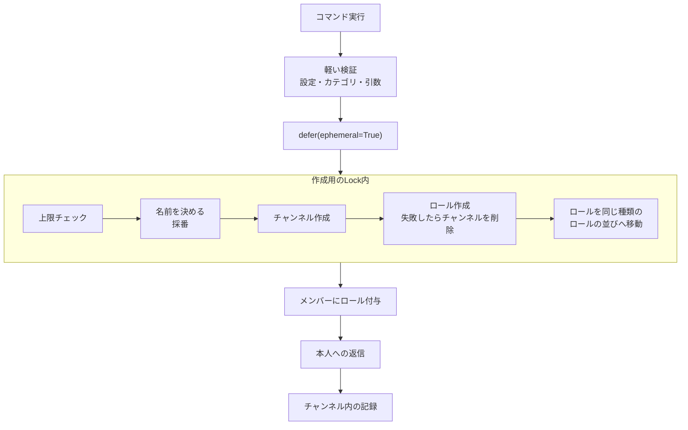

# アーキテクチャガイド

このドキュメントでは、InTech Discord Botの技術スタックとアーキテクチャパターンについて説明します。

## 📋 目次

1. [技術スタック](#技術スタック)
2. [アーキテクチャパターン](#アーキテクチャパターン)
3. [コマンド登録システム](#コマンド登録システム)
4. [設定管理](#設定管理)
5. [番号の採番](#番号の採番)
6. [作成の直列化と上限チェック](#作成の直列化と上限チェック)
7. [記録の出し先](#記録の出し先)

## 技術スタック

- **言語**: Python 3.11+
- **Discordフレームワーク**: discord.py 2.6.4+ (モダンなスラッシュコマンド with `app_commands`)
- **Webサーバー**: FastAPI + uvicorn (Keep-alive用ヘルスチェックサーバー)
- **パッケージマネージャー**: `uv` (モダンなPythonパッケージマネージャー)
- **デプロイ**: Fly.io (東京リージョン、Docker ベース)

## アーキテクチャパターン

### デュアルサーバーアーキテクチャ

Botは2つの並列サーバーを実行します:

1. **Discord Bot** ([bot.py](../bot.py)) - スラッシュコマンドを持つメインのDiscordクライアント
2. **FastAPI Server** ([keep_alive.py](../keep_alive.py)) - ヘルスチェックエンドポイント (`/`, `/health`, `/ping`)

両方のサーバーは[bot.py](../bot.py)内で`asyncio.gather()`を使用して実行されます。これにより、HTTPエンドポイントを必要とするプラットフォーム(Fly.ioなど)へのデプロイが可能になります。

**実装コード** ([bot.py](../bot.py)):
```python
async def main():
    async with bot:
        # Discord BotとFastAPIサーバーを並列実行
        await asyncio.gather(
            bot.start(token),
            run_keep_alive()
        )
```

### ステートレス設計

**データベース不要** - すべての状態はDiscord上に存在:

- チャンネル、ロール、カテゴリーが唯一の真実の情報源
- Botを再起動してもデータ損失なし
- 設定は環境変数から取得

この設計により、以下のメリットがあります:
- シンプルな構成（DBサーバー不要）
- 高い可用性（状態同期の問題なし）
- 簡単なバックアップ（Discordが管理）

## コマンド登録システム

**これがコードベースで最も重要なアーキテクチャパターンです。**

### 自動検出と登録

コマンドは起動時に自動検出・登録されます:

1. **場所**: [src/commands/\_\_init\_\_.py](../src/commands/__init__.py)
2. **自動検出**: `src/commands/` 内のファイルが自動的にロードされます（`_*.py` ファイルを除く）
3. **各コマンドモジュール**は `setup(tree: app_commands.CommandTree)` 関数を持つ必要があります
4. **動的ロード**: `importlib` を使用したクリーンなモジュール管理

### 登録の仕組み

[src/commands/\_\_init\_\_.py](../src/commands/__init__.py):
```python
def register_commands(tree: app_commands.CommandTree):
    """自動的にコマンドを登録"""
    commands_dir = Path(__file__).parent

    for file_path in commands_dir.glob("*.py"):
        # _で始まるファイル（__init__.py, _sample.pyなど）を除外
        if file_path.stem.startswith("_"):
            continue

        # モジュールを動的にインポート
        module_name = f"src.commands.{file_path.stem}"
        module = importlib.import_module(module_name)

        # setup関数を呼び出してコマンドを登録
        if hasattr(module, "setup"):
            module.setup(tree)
```

### 新しいコマンドの追加

1. `src/commands/` に新しいファイルを作成（例: `my_command.py`）
2. `setup(tree)` 関数を実装
3. デコレーターパターンを使用（詳細は[ADD_COMMAND.md](./ADD_COMMAND.md)参照）
4. コマンドは自動的に `/help` と `/docs` に表示されます

**テンプレート**: [src/commands/\_sample.py](../src/commands/_sample.py)を起点として使用

### コマンドの同期

開発環境と本番環境で異なる同期戦略を使用:

**開発環境** (`.env.dev` with `DEV_GUILD_ID`):
```python
if dev_guild_id:
    # 即座に同期（開発モード）
    guild = discord.Object(id=int(dev_guild_id))
    tree.copy_global_to(guild=guild)
    synced = await tree.sync(guild=guild)
```

**本番環境** (`.env` without `DEV_GUILD_ID`):
```python
else:
    # グローバル同期（最大1時間かかる）
    synced = await tree.sync()
```

## 設定管理

### 非同期設定ロード

[src/utils/channel_config.py](../src/utils/channel_config.py)で実装:

```python
class ChannelConfig:
    """環境変数を管理する設定クラス"""

    @classmethod
    async def load(cls, ctx: discord.Interaction) -> "ChannelConfig | None":
        """非同期で設定をロード"""
        # 環境変数を読み込み、バリデーション
        # エラーメッセージは自動表示
```

**特徴**:
- 非同期ロード (`await ChannelConfig.load(ctx)`)
- コマンド実行時に環境変数を検証
- バリデーションエラーは自動的にユーザーに表示（不足している環境変数だけを並べる）
- イベント・プロジェクト・クラブの設定に対応

**使用例**:
```python
from src.utils.channel_config import ChannelConfig

config = await ChannelConfig.load(ctx)
if not config:
    return  # エラーメッセージは既に表示済み

category_name = config.event_category_name
```

## 番号の採番

### 番号のフォーマット

クラブ・イベント・プロジェクトのチャンネルは、種類を表す一文字と3桁の番号を先頭に付けます。チャンネルとロールはこの番号で結びつきます（用語は[CONTEXT.md](../CONTEXT.md)の「番号」）。

| 種類 | チャンネル名 | ロール名 |
|---|---|---|
| クラブ | `c001-ラーメン` | `c001-ラーメン`（番号＋名前） |
| イベント | `e001-おでん会` | `e001`（番号のみ） |
| プロジェクト | `p001-ハッカソン` | `p001`（番号のみ） |

種類ごとの違い（頭文字・ラベル・ロール名の規則）は[src/utils/kinds.py](../src/utils/kinds.py)の`Kind`にまとめています。コマンドは種類によらず共通で、種類ごとの値を`Kind`から引きます（コマンドは[CHANNELS.md](./CHANNELS.md)）。

### 採番

[src/utils/channel_utils.py](../src/utils/channel_utils.py)の`get_next_number`で行います。

- その種類の通常のカテゴリとアーカイブカテゴリにあるチャンネル名、およびすべてのロール名から、種類の頭文字の番号を読み取る
- 最大の番号に1を足す（なければ1）。欠番は埋めない（番号は再利用しない）
- ロール名も見るのは、チャンネルだけ消されてロールが残っている番号を避けるため
- 999を使い切っていたら作成を拒否する

### 紐づけ

ロールとチャンネルは番号で結びつけます（[src/utils/linking.py](../src/utils/linking.py)）。ロールからは種類の形（club: `cNNN-名前`、event: `eNNN`、project: `pNNN`）で種類を判定し、同じ番号のチャンネルをその種類の通常のカテゴリとアーカイブカテゴリから探します。チャンネルからは、置かれているカテゴリで種類を判定します。同じ番号のロールやチャンネルが複数あれば、どれを使うか決められないのでエラーにします。

## 作成の直列化と上限チェック

チャンネルとロールの作成は[src/utils/creation.py](../src/utils/creation.py)の`create_channel_with_role`に集約しています。承認がないため、上限を超える作成や番号の重複を防ぐのはこの処理です。



- **Lockはサーバー全体で1つ**（モジュールレベルの`creation_lock`）。上限はサーバー全体で共有されるため、3種類の作成コマンドで同じLockを使います。botが1プロセスで動くこと（`fly.toml`の`max_machines_running = 1`）が前提です
- **上限**（[src/utils/capacity.py](../src/utils/capacity.py)）: 1カテゴリ50チャンネル、1サーバー500チャンネル（カテゴリ込み）、1サーバー250ロール（@everyone込み）。ちょうど上限に達していたら作成しません。アーカイブと復元は移動先カテゴリの50件だけを確認します
- **キャッシュに現れていないロールも数える**: discord.pyは`create_text_channel`の戻り値をキャッシュに入れますが、`create_role`は入れません（gatewayのイベントで入る）。そのままだと直後の作成の上限チェックでロール数が少なく数えられるため、作成したロールのIDをサーバーごとに覚えておき、キャッシュに現れるまでは上限チェックで足して数えます。Lockを持ったまま待つことはしません

### ロールの並び

ロールは種類ごとにまとめ、上から club → event → project の順に並べます。新しく作ったロールはDiscordの仕様で一番下（@everyoneのすぐ上）に作られるため、作成用のLockの中で動かします（[src/utils/role_order.py](../src/utils/role_order.py)の`target_role_position`）。

- 同じ種類のロールがあれば、その一番下に置く（同じ種類の中では作成順に並ぶ）
- なければ、下の種類のロールの一番上のすぐ上に置く。下の種類もなければ動かさない
- 種類はロール名で判定する（club: `cNNN-名前`、event: `eNNN`、project: `pNNN`）
- 位置は`guild.fetch_roles()`で取り直した最新の一覧から決め、`guild.edit_role_positions`で送る。作成直後のロールはキャッシュになく、他のロールの位置もずれる前のままなので、`Role.edit(position=...)`（キャッシュから組み立てる）では動かせない
- botは自分のロールより上には動かせない。動かせなくても作成は成功扱いにし、warningを出す
- 既存のロールは並べ替えない（手で並べる）

### チャンネルの並び

アーカイブと復元のあと、移動先カテゴリのテキストチャンネルを番号の小さい順に並べ直します（[src/utils/channel_order.py](../src/utils/channel_order.py)の`move_channel`・`sort_category`）。アーカイブカテゴリは種類ごとに分ける前提です（並べ直しは1つの種類の番号で行うため）。

- チャンネルの位置（position）はサーバー全体で通しの値で、カテゴリ内ではその小さい順に表示される。カテゴリだけを変えて移動すると移動前の位置を持ち越すため、移動先で不自然な場所に入る（`e001`の上に`e017`が入る、など）
- キャッシュの位置は古いことがあるので、`guild.fetch_channels()`で最新の一覧を取り直してから並べ、変わる位置だけをまとめて送る
- 番号のないチャンネル（案内用など）は、今の並びのまま番号つきのチャンネルより上に置く
- ボイスチャンネルは並べない
- 並べ直しに失敗しても、移動は成功扱いにしてwarningを出す

## 記録の出し先

botの操作の記録は、読み手ごとに、その読み手がいる場所に残します（用語は[CONTEXT.md](../CONTEXT.md)の「記録」）。実行した場所には操作した本人への返信を残し、対象チャンネルには操作の記録を残します。実行した場所と対象チャンネルが同じ場合は、両方がそのチャンネルに残ります。

| 操作 | チャンネル内の記録（対象チャンネル） | 本人への返信（ephemeral） |
|---|---|---|
| 作成 | 誰が立てたか・ロール・参加者・参加方法 | 完了 |
| 参加者の追加 | 誰が誰を加えたか | 完了（既にロールを持つ人・付与に失敗した人も伝える。誰にも付与できなければエラー） |
| 参加者の削除 | 誰が誰を外したか（外された人は通知しない） | 完了（ロールを持っていない人・外せなかった人も伝える。誰からも外せなければエラー） |
| アーカイブ | 誰がアーカイブしたか・復元方法（移動の**前**に投稿し、移動に失敗したら削除） | 完了 |
| 復元 | 誰が復元したか（移動の後に投稿） | 完了 |
| 投稿による自動復元 | 誰の投稿で復元したか（移動の後に投稿。通知しない） | なし（戻し先が上限なら、きっかけの投稿に返信で理由を伝える） |

- Embedのタイトルは記録の種類を示すラベル（「イベント作成」「参加者の追加」「参加者の削除」「アーカイブ」「復元」）にし、本文を「誰が・何を・どうした」の一文にそろえます（タイトルではメンションが展開されないため、メンションは本文に書きます）。手段（参加方法・復元方法）はEmbedの項目に分けます
- 作成した本人は、立てた時点で参加者になります（ロールが付きます）

- **サーバー全体で1か所に集めるログチャンネルは置きません**。誰が操作したかは対象チャンネルの記録に残り、新しいチャンネルには参加者への通知とDiscordのチャンネル一覧で気づけるためです
- **チャンネル内の記録**: 対象チャンネルの参加者向け。作成時に参加者にした人（立てた本人を含む）と、参加者の追加で加えられた人だけを本文のメンションで通知します（Embed内のメンションは通知されないため）。プッシュ通知には本文だけが出るので、「参加者: @a @b」「新しい参加者: @c」のように何の通知かを添えます。ロールや@everyoneは鳴らしません（ロールのメンションは、通知設定でロールのメンションを無効にしている人に届かないため）
- **本人への返信**: 毎回`ephemeral=True`を明示して送ります（2通目以降のfollowupはdeferの可視性を引き継がないため）
- 記録の送信に失敗してもコマンドは失敗扱いにせず、warningを出すだけにします
- スレッドから引数を省略して実行した場合は親チャンネルを対象にし、そのことを本人への返信で伝えます

実装は[src/utils/records.py](../src/utils/records.py)です。

## デプロイ構成

### Fly.io設定 ([fly.toml](../fly.toml))

- **リージョン**: Tokyo (NRT)
- **リソース**: 1GB RAM, 1 shared CPU
- **自動起動**: 有効
- **ヘルスチェック**: FastAPIサーバー経由のHTTP

### デプロイプロセス

1. `main` ブランチへのプッシュ
2. GitHub Actionsがデプロイワークフローをトリガー
3. Fly.ioがDockerイメージをビルド
4. 新しいインスタンスが東京リージョンにデプロイ
5. ヘルスチェックでデプロイメントを検証

## 関連ドキュメント

- [コマンド追加方法](./ADD_COMMAND.md) - 新しいコマンドの追加手順
- [ユーティリティ関数](./UTILITIES.md) - 共通ユーティリティの使い方
- [開発ガイド](./DEVELOPMENT.md) - 開発ワークフローとCI/CD
