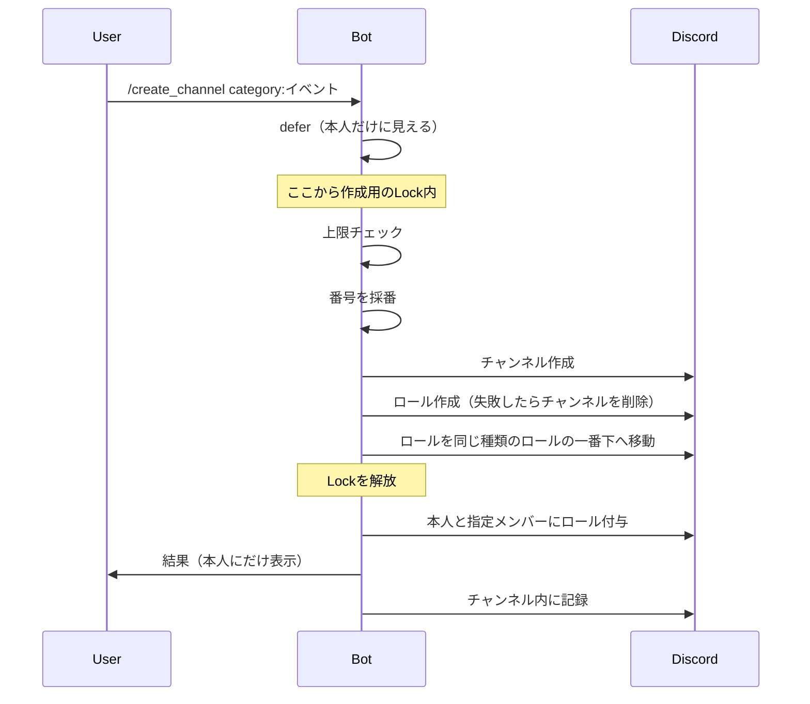

# チャンネル管理

## 📖 概要

クラブ・イベント・プロジェクトのチャンネルとロールを作り、アーカイブ・復元し、参加者を出し入れする機能です。3種類とも同じコマンドで操作します。チャンネルとロールは**番号**（`c001` / `e001` / `p001`）で結びつきます（用語は[CONTEXT.md](../CONTEXT.md)）。

| コマンド | 内容 |
|---|---|
| `/create_channel category channel_name [members]` | チャンネルとロールを作成。`category`で種類を選ぶ |
| `/archive_channel [channel]` | その種類のアーカイブカテゴリへ移す |
| `/restore_channel [channel]` | その種類の通常のカテゴリへ戻す |
| `/add_role_members members [role]` | ロールに参加者を加える |
| `/remove_role_members members [role]` | ロールから参加者を外す |

作成以外は、対象のチャンネル（アーカイブ・復元）やロール（参加者の出し入れ）から種類を判定するので、種類を指定しません。`channel`・`role`を省略すると、実行したチャンネル（スレッドなら親チャンネル）が対象になります。

## 🏗️ 構成

```
src/commands/channel.py             # 5つのコマンド

src/utils/
├── kinds.py                        # 種類ごとの違い（頭文字・ラベル・ロール名の規則）
├── linking.py                      # 番号によるチャンネルとロールの紐づけ
├── numbering.py                    # 番号の採番と読み取り
├── creation.py                     # 作成の共通処理（上限チェック・ロールバック・ロールの移動）
├── role_order.py                   # 作成したロールの置き場所
├── channel_order.py                # 移動と、移動先カテゴリの並べ直し
├── role_utils.py                   # ロールの付与と削除
└── records.py                      # 記録
```

### 種類ごとの違い

| 種類 | チャンネル名 | ロール名 | カテゴリ（環境変数） |
|---|---|---|---|
| クラブ | `c001-ラーメン` | `c001-ラーメン`（番号＋名前） | `CLUB_CATEGORY_NAME` / `ARCHIVE_CLUB_CATEGORY_NAME` |
| イベント | `e001-おでん会` | `e001`（番号のみ） | `EVENT_CATEGORY_NAME` / `ARCHIVE_EVENT_CATEGORY_NAME` |
| プロジェクト | `p001-ハッカソン` | `p001`（番号のみ） | `PROJECT_CATEGORY_NAME` / `ARCHIVE_PROJECT_CATEGORY_NAME` |

クラブは常設なので、メンションしたときに何のクラブか分かるよう、ロール名に名前も含めます。アーカイブカテゴリは種類ごとに分けます（並べ直しが種類の番号順で行うため）。同じカテゴリを共有する設定にした場合も、チャンネル名の頭文字で種類を判定するので別の種類のカテゴリへ戻ることはありませんが、並べ直しは1つの種類の番号でしか行われません。

## 🔧 実装詳細

### 作成



### 番号での紐づけ

チャンネルとロールは、名前の先頭の番号で結びつけます（`linking.py`）。名前の部分はDiscordの正規化（小文字化、空白をハイフンに、など）でずれることがありますが、番号はずれません。

参加者の追加・削除は、次をすべて満たすロールだけを操作します。

1. ロール名が種類の形をしている（club: `cNNN-名前`、event: `eNNN`、project: `pNNN`）
2. 同じ番号のロールがほかにない
3. 同じ番号のチャンネルが、その種類の通常のカテゴリかアーカイブカテゴリにちょうど1つある
4. 管理者ロールなどの重要なロールではない（`validate_role_safety`）

番号が重なるのは手作業で名前を変えた場合だけですが、どれを使うか決められないのでエラーにします。

### 番号の採番

その種類の通常のカテゴリとアーカイブカテゴリにあるチャンネル名、およびロール名のうち、種類の頭文字の番号の最大に1を足します（`channel_utils.py`の`get_next_number`）。欠番は埋めません。ロール名も見るのは、チャンネルだけ消されてロールが残っている番号を再利用しないためです。999を使い切ったら作成を拒否します。

### アーカイブ・復元

対象チャンネルのあるカテゴリから種類と「アーカイブ中かどうか」を決め（`linking.py`の`locate_channel`）、反対側のカテゴリへ移したあと、移動先をその種類の番号順に並べ直します（`channel_order.py`の`move_channel`）。アーカイブの記録は、アーカイブ先でbotが送信できない可能性があるため移動の**前**に投稿し、移動に失敗したら消します。

### 投稿による自動復元

アーカイブ中のチャンネル（またはそのスレッド）に人が投稿すると、botがその種類の通常のカテゴリへ戻します（`auto_restore.py`の`restore_on_post`、`bot.py`の`on_message`から呼ぶ）。アーカイブカテゴリの権限で、メンバーが送信できるようにしておく必要があります。

- botとwebhookの投稿、ピン留めやスレッド作成などのシステムメッセージは数えない。リアクションも数えない
- 連投で二重に戻さないよう、チャンネルごとに直列化し、移動の直前に最新のカテゴリを取り直して確かめる
- 戻したら「@x がメッセージを送ったので、`📅 イベント` カテゴリーに戻しました」をチャンネル内に記録する（通知はしない）
- 戻し先のカテゴリが上限（50）なら戻さず、その投稿に返信で理由を伝える
- 移動に失敗しても例外は出さず、warningを出す

### 参加者の削除

外された人には通知しません。チャンネル内の記録には誰が誰を外したかを残しますが、メンションはEmbedの中にだけ書きます（Embed内のメンションは通知されない）。

## 🐛 トラブルシューティング

### Q: ロールに参加者を追加できない

**原因:**
1. ロール名が種類の形をしていない、または同じ番号のチャンネルがその種類のカテゴリにない
2. 同じ番号のロールやチャンネルが複数ある
3. 管理者ロールなど重要なロールを操作しようとしている

**解決策:**
- チャンネル名とロール名の番号を手で揃える
