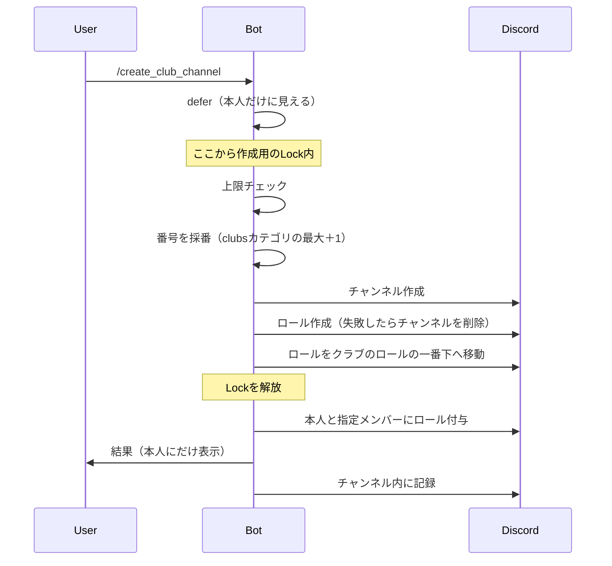

# クラブチャンネル管理システム

## 📖 概要

クラブ（共通の興味でゆるく集まる常設の趣味部屋）のチャンネルとロールを、1つのコマンドで作って管理する機能です。チャンネルとロールは**番号**（`c001`など）で結びつきます。

### 主な機能

- **チャンネルとロールの一括作成**: チャンネル `c001-ラーメン` とロール `c001-ラーメン` を同時に作成
- **どこからでも作成**: 承認不要。どのチャンネル・スレッドからでも実行可能
- **メンバー管理**: 作成時または後からメンバーをロールに追加可能。作成した本人は自動で参加者になる
- **ロールの並び**: 作成したロールをクラブのロールの一番下に置く（event/projectのロールより上）
- **上限チェック**: カテゴリ・サーバーのチャンネル数やロール数が上限なら作成しない
- **記録**: 作成とメンバー追加をクラブのチャンネル内に残す（[ARCHITECTURE.md](./ARCHITECTURE.md#記録の出し先)）

## 🏗️ アーキテクチャ

### コンポーネント構成

```
src/commands/club_channel.py
├── create_club_channel_impl()      # チャンネル作成実装
├── add_club_role_member_impl()     # ロールメンバー追加実装
└── setup()                         # コマンド登録

src/utils/
├── numbering.py                    # 番号の採番と読み取り
├── role_order.py                   # 作成したロールの置き場所
├── creation.py                     # 作成の共通処理（上限チェック・ロールバック・ロールの移動）
├── records.py                      # 記録
├── channel_config.py               # 環境変数管理
├── channel_utils.py                # チャンネルユーティリティ
├── validation_utils.py             # バリデーション
└── message_utils.py                # メッセージヘルパー
```

### 環境変数

```bash
CLUB_CATEGORY_NAME="clubs"                    # クラブチャンネルを作成するカテゴリー名
```

## 💡 使い方

### クラブチャンネルの作成

```
/create_club_channel channel_name:ラーメン members:@user1 @user2
```

**実行結果:**
- チャンネル: `c005-ラーメン`（clubsカテゴリ内。番号は使われている最大の番号＋1）
- ロール: `c005-ラーメン`（メンション可能。クラブのロールの一番下に置く）
- 作成した本人、@user1、@user2 にロールを付与

クラブは常設なので、メンションしたときに何のクラブか分かるよう、ロール名は番号＋名前にしています（event/projectのロールは番号だけ）。

### ロールへのメンバー追加

```
/add_club_role_member members:@user3 @user4
/add_club_role_member members:@user3 role_name:@c005-ラーメン
```

`role_name`を省略すると、実行したチャンネル（スレッドなら親チャンネル）と同じ番号のロールが対象になります。

## 🔧 実装詳細

### チャンネル作成フロー



### 番号での紐づけ

チャンネルとロールは、名前の先頭の番号（`c005-`）で結びつけます。名前の部分はDiscordの正規化（小文字化、空白をハイフンに、など）でずれることがありますが、番号はずれません。

`/add_club_role_member`は、次をすべて満たすロールだけを操作します。

1. ロール名が `cNNN-` で始まる
2. 同じ番号のチャンネルがclubsカテゴリにある
3. 管理者ロールなどの重要なロールではない（`validate_role_safety`）

番号で結びつけるため、既存の権限つきロール（例: `運営`）と同じ名前のクラブを作っても、そのロールを操作できるようにはなりません。同じ名前のクラブも、番号で区別できるので作成できます。

### 番号の採番

clubsカテゴリにあるチャンネルのうち、`cNNN-` で始まるものの最大の番号に1を足します（`numbering.py`の`next_number`）。欠番は埋めません。clubにはまだアーカイブがないため、clubsカテゴリだけを見ます。

### ロールの置き場所

新しく作ったロールはDiscordの仕様で一番下（@everyoneのすぐ上）に作られるため、作成後に動かします（`role_order.py`の`target_role_position`）。

- 同じ種類のロールがあれば、その一番下に置く
- なければ、下の種類（club＞event＞projectの順）のロールの一番上のすぐ上に置く
- botは自分のロールより上には動かせない。動かせなくても作成は成功扱いにし、warningを出す

## 🆚 イベントチャンネルとの比較

| 機能 | イベントチャンネル | クラブチャンネル |
|------|------------------|----------------|
| **チャンネル名** | `e001-ハッカソン` | `c001-ラーメン` |
| **ロール名** | `e001`（番号のみ） | `c001-ラーメン`（番号＋名前） |
| **採番の範囲** | イベントカテゴリとアーカイブカテゴリ | clubsカテゴリ |
| **アーカイブ・復元** | ✅ | ❌（#16で対応予定） |

## 🐛 トラブルシューティング

### Q: ロールにメンバーを追加できない

**原因:**
1. ロール名が `cNNN-` で始まっていない、または同じ番号のチャンネルがclubsカテゴリにない
2. 管理者ロールなど重要なロールを操作しようとしている

**解決策:**
- 番号のついていない古いクラブは、チャンネル名とロール名を `cNNN-名前` に手で揃える

## 📚 参考実装

- `src/commands/club_channel.py` - メインロジック
- `src/utils/numbering.py` - 番号の採番と読み取り
- `src/utils/role_order.py` - ロールの置き場所
- `src/utils/creation.py` - 作成の共通処理
