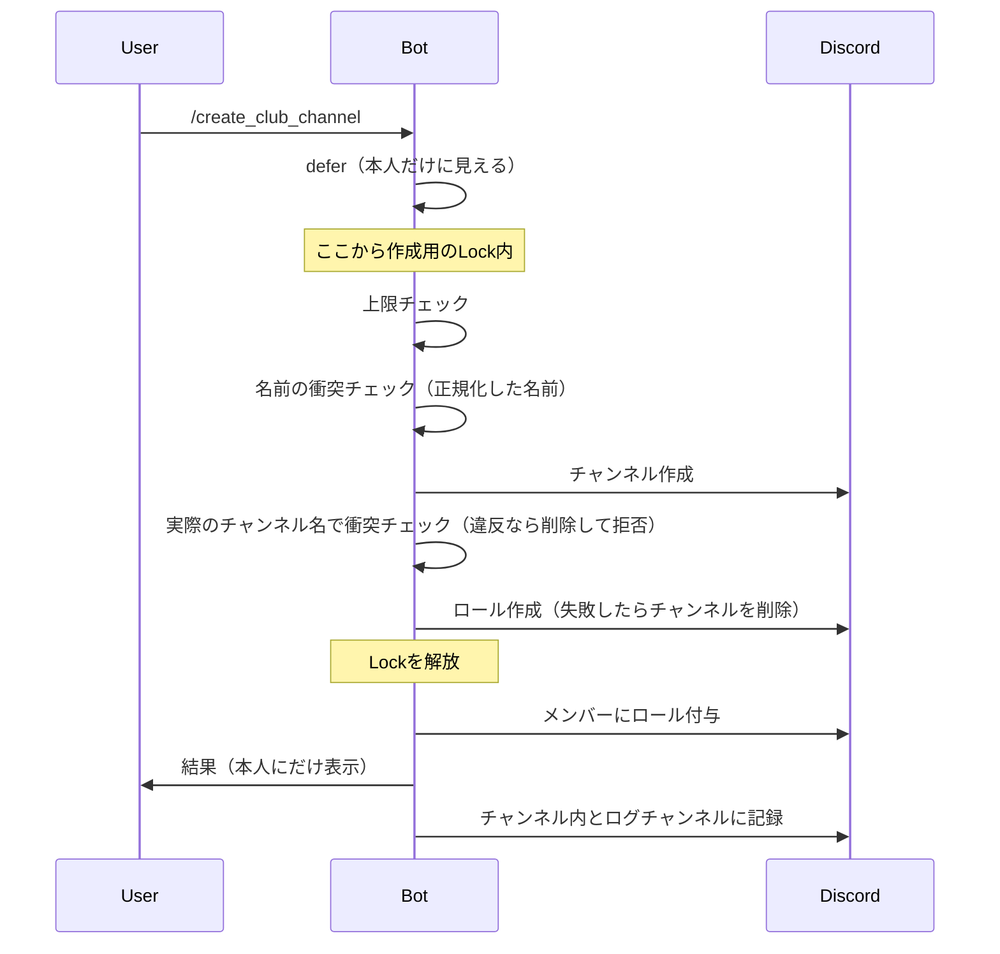

# クラブチャンネル管理システム

## 📖 概要

クラブチャンネル管理システムは、サークルやクラブ活動用のDiscordチャンネルとロールを一元管理する機能です。チャンネル作成時に同名のロールを自動生成し、メンバー管理を簡単に行えます。

### 主な機能

- **チャンネルとロールの一括作成**: 1つのコマンドでチャンネルとロールを同時に作成
- **どこからでも作成**: 承認不要。どのチャンネル・スレッドからでも実行可能
- **メンバー管理**: 作成時または後からメンバーをロールに追加可能
- **名前の衝突チェック**: 同名チャンネル、既存ロール、番号の形式（`e001`など）、ログチャンネル名と衝突する名前を拒否
- **上限チェック**: カテゴリ・サーバーのチャンネル数やロール数が上限なら作成しない
- **記録**: 作成とメンバー追加をログチャンネルと対象チャンネルに残す（[ARCHITECTURE.md](./ARCHITECTURE.md#記録の出し先)）

## 🏗️ アーキテクチャ

### コンポーネント構成

```
src/commands/club_channel.py
├── create_club_channel_impl()      # チャンネル作成実装
├── add_club_role_member_impl()     # ロールメンバー追加実装
└── setup()                         # コマンド登録

src/utils/
├── channel_config.py               # 環境変数管理
├── channel_utils.py                # チャンネルユーティリティ
├── club_name.py                    # クラブ名の検証
├── creation.py                     # 作成の共通処理（上限チェック・ロールバック）
├── records.py                      # 記録
├── validation_utils.py             # バリデーション
└── message_utils.py                # メッセージヘルパー
```

### 環境変数

`.env` ファイルで以下の変数を設定:

```bash
# クラブチャンネル管理用の設定
CLUB_CATEGORY_NAME="clubs"                    # クラブチャンネルを作成するカテゴリー名
LOG_CHANNEL_NAME="bot-log"                    # 記録を残すログチャンネル名
```

## 💡 使い方

### クラブチャンネルの作成

#### 基本的な作成

```
/create_club_channel channel_name:プログラミング部
```

**実行結果:**
- チャンネル: `プログラミング部` (clubsカテゴリ内)
- ロール: `プログラミング部` (メンション可能)

#### メンバー付きで作成

```
/create_club_channel channel_name:ロボット研究会 members:@user1 @user2
```

**実行結果:**
- チャンネル: `ロボット研究会`
- ロール: `ロボット研究会`
- @user1 と @user2 にロールを自動付与

### ロールへのメンバー追加

#### クラブチャンネル内で実行

```
/add_club_role_member members:@user3 @user4
```

実行チャンネル名のロールにメンバーを追加します。スレッドから実行した場合は親チャンネルが対象になります。

#### 任意の場所で実行

```
/add_club_role_member members:@user3 @user4 role_name:@プログラミング部
```

指定したロールにメンバーを追加します。

## 🔧 実装詳細

### チャンネル作成フロー



### 名前の衝突チェックの仕組み

クラブはチャンネルとロールを**名前で**結びつけます。そのため、既存の権限つきロールと同じ名前のクラブを作れると、`/add_club_role_member`でそのロールを自分に付与できてしまいます。これを防ぐため、`validate_club_name`（`src/utils/club_name.py`）で次の名前を拒否します。

- 番号の形式（`e001`、`c012-x`など）
- ログチャンネル名
- 既存のロール名
- **clubsカテゴリ内**の同名チャンネル

Discordはチャンネル名を正規化します（小文字化、空白をハイフンに、など）。規則は公開されていないため、作成前に近似した正規化で検査し、作成後に実際の`channel.name`でもう一度検査します。ロールは実際の`channel.name`で作るので、チャンネル名とロール名がずれることはありません。

### ロールメンバー追加の制限

安全性のため、以下の制限があります:

1. **カテゴリチェック**: clubsカテゴリ内のチャンネルに対応するロールのみ操作可能
2. **ロール安全性チェック**: 管理者ロールなど重要なロールは操作不可
3. **チャンネル存在チェック**: ロールに対応するチャンネルが存在する必要がある

```python
# 同名のチャンネルがCLUB_CATEGORY_NAMEカテゴリーに存在するか確認
channel_dict = {ch.name: ch for ch in club_category.text_channels}
club_channel = channel_dict.get(role_name)
if not club_channel:
    # エラー: このロールは操作できません
    return
```

## 📝 コマンド実装例

### create_club_channel コマンド

```python
@command_meta(
    category="クラブチャンネル管理",
    icon="🏛️",
    short_description="クラブ用のチャンネルとロールを作成",
    restrictions="• どのチャンネル・スレッドからでも実行可能",
    examples=[
        "`/create_club_channel channel_name:プログラミング部`",
        "`/create_club_channel channel_name:ロボット研究会 members:@user1 @user2`",
    ],
)
@tree.command(
    name="create_club_channel",
    description="新しいクラブチャンネルを作成します",
)
@app_commands.describe(
    channel_name="作成するクラブチャンネル名",
    members="ロールに追加するメンバー（メンション形式で複数指定可能。例: @user1 @user2）",
)
async def create_club_channel(
    ctx: discord.Interaction, channel_name: str, members: str | None = None
):
    await create_club_channel_impl(ctx, channel_name, members)
```

**デコレーターの順序（重要）:**
1. `@command_meta()` - メタデータ登録
2. `@tree.command()` - コマンド登録
3. `@app_commands.describe()` - パラメータ説明

### add_club_role_member コマンド

```python
@command_meta(
    category="ロール管理",
    icon="👥",
    short_description="クラブロールにメンバーを追加",
    restrictions="• 一部ロール以外のみ対象",
    examples=[
        "`/add_club_role_member members:@user1 @user2`",
        "`/add_club_role_member members:@user1 role_name:@プログラミング部`",
    ],
)
@tree.command(
    name="add_club_role_member",
    description="クラブチャンネルに紐づくロールにメンバーを追加します",
)
@app_commands.describe(
    members="追加するメンバー（メンション形式で複数指定可能。例: @user1 @user2）",
    role_name="対象のロール（@ロール形式で指定。例: @プログラミング部 省略時は実行チャンネルのロール）",
)
async def add_club_role_member(
    ctx: discord.Interaction, members: str, role_name: str | None = None
):
    await add_club_role_member_impl(ctx, members, role_name)
```

## 🆚 イベントチャンネルとの比較

| 機能 | イベントチャンネル | クラブチャンネル |
|------|------------------|----------------|
| **チャンネル名** | `e001-ハッカソン` (インデックス付き) | `プログラミング部` (名前のみ) |
| **インデックス管理** | ✅ 自動採番 (3桁0埋め) | ❌ なし |
| **ロール作成** | ✅ | ✅ |
| **メンバー追加** | ✅ | ✅ |
| **上限チェック** | ✅ | ✅ |
| **記録** | ✅ | ✅ |
| **アーカイブ機能** | ✅ | ❌ |
| **復元機能** | ✅ | ❌ |
| **名前の衝突チェック** | 番号で採番するため不要 | 同名チャンネル・既存ロール・番号形式・ログチャンネル名 |

**設計思想の違い:**
- **イベント**: 一時的な活動、インデックスで管理、アーカイブ可能
- **クラブ**: 恒久的な組織、名前で管理、シンプルな構造

## 🔒 セキュリティとバリデーション

### 実施しているチェック

1. **環境変数の検証**
   ```python
   config = await ChannelConfig.load(ctx)
   if not config:
       return  # エラーメッセージは自動表示
   ```

2. **カテゴリ存在チェック**
   ```python
   category_channel = await validate_category_exists(ctx, guild, config.club_category_name)
   if not category_channel:
       return  # エラーメッセージは自動表示
   ```

3. **名前の衝突チェック**（作成用のLock内で、作成前と作成後に実施）
   ```python
   reason = validate_club_name(
       name,
       log_channel_name=config.log_channel_name,
       existing_role_names=[role.name for role in guild.roles],
       existing_channel_names=[ch.name for ch in category_channel.text_channels],
   )
   ```

4. **メンバーメンションのパース**
   ```python
   parsed_members = await parse_member_mentions(ctx, members, guild)
   if parsed_members is None:
       return  # エラーメッセージは自動表示
   ```

5. **ロール安全性チェック**
   ```python
   if not await validate_role_safety(ctx, role):
       return  # 管理者ロールなど重要なロールは操作不可
   ```

### エラーハンドリング

チャンネルとロールの作成は`create_channel_with_role`（`src/utils/creation.py`）が行い、結果を`Created` / `Rejected` / `Failed`で返します。ロールの作成に失敗した場合はチャンネルを削除して元に戻します。

```python
outcome = await create_channel_with_role(
    guild,
    category_channel,
    decide_name=decide_name,
    validate_created_name=...,
    role_name_for=lambda channel: channel.name,
)
if not isinstance(outcome, Created):
    await report_creation_problem(ctx, outcome, "クラブチャンネルの作成")
    return
```

## 🎯 ベストプラクティス

### 1. チャンネル名の命名規則

**推奨:**
- 簡潔でわかりやすい名前
- 日本語OK（例: `プログラミング部`）
- 英語もOK（例: `programming-club`）

**非推奨:**
- 長すぎる名前（Discordの制限: 100文字）
- 特殊文字の多用
- 既存のチャンネルと紛らわしい名前

### 2. メンバー管理

**作成時に追加:**
```
/create_club_channel channel_name:新入生歓迎会 members:@部長 @副部長
```

**後から追加:**
```
/add_club_role_member members:@新メンバー1 @新メンバー2
```

### 3. エラー対応

**同名チャンネルが存在する場合:**
```
❌ 同じ名前のチャンネルが既にあります。
```

**対処法:**
- 別の名前を使用する（例: `プログラミング部2024`）
- 既存のチャンネルを確認する

## 🔗 関連ドキュメント

- [ARCHITECTURE.md](./ARCHITECTURE.md) - 記録の出し先
- [UTILITIES.md](./UTILITIES.md) - ユーティリティ関数の使い方
- [ADD_COMMAND.md](./ADD_COMMAND.md) - 新しいコマンドの追加方法

## 🐛 トラブルシューティング

### Q: ロールにメンバーを追加できない

**原因:**
1. 対象ロールがclubsカテゴリのチャンネルに対応していない
2. 管理者ロールなど重要なロールを操作しようとしている

**解決策:**
- clubsカテゴリ内のチャンネル名と同じロールを指定
- `/add_club_role_member` は通常のクラブロールのみ操作可能

### Q: 同じ名前のチャンネルが作れない

**これは正常な動作です。**

**理由:**
- 同一カテゴリ内での重複を防ぐため
- ユーザーの混乱を避けるため

**解決策:**
- 年度を付ける（例: `プログラミング部2024`）
- 番号を付ける（例: `プログラミング部2`）
- 既存チャンネルの用途を見直す

## 📚 参考実装

完全な実装は以下のファイルを参照:
- `src/commands/club_channel.py` - メインロジック
- `src/utils/channel_config.py` - 設定管理
- `src/utils/channel_utils.py` - チャンネルユーティリティ
- `src/utils/club_name.py` - クラブ名の検証
- `src/utils/creation.py` - 作成の共通処理
- `src/utils/validation_utils.py` - バリデーション
